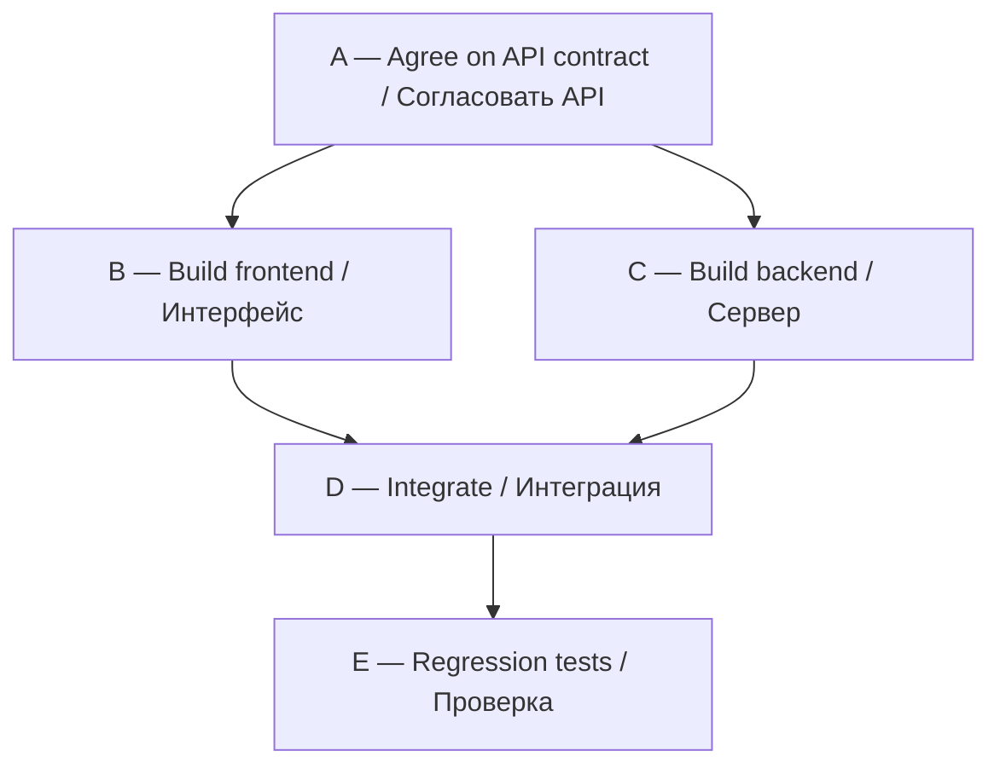

# DAG Orchestrator Desktop — demonstration / Демонстрация

**Version 2.3.0 · Developer: David Pagava (Давид Пагава)**

**This is a reproducible workflow example, not a recorded execution.** The diagram illustrates dependency gating. Parallel execution requires a Claude session that genuinely supports launching subagents; the MCP server does not launch them itself.

**Это воспроизводимый пример, а не видеозапись выполненного запуска.** Схема показывает зависимости. Параллельная работа возможна только в среде Claude с доступными субагентами: MCP сам их не запускает.

## Example DAG / Пример графа



**Dependency rules / Правила:**

- A must complete before B or C is eligible.
- B and C can be eligible together **if** their file ownership and resource locks do not conflict.
- D cannot start until both B and C are completed.
- E cannot start until D is completed.
- This is orchestration, **not a claim of guaranteed parallel speed-up**.

## Try the local MCP smoke test / Быстрая проверка MCP

Requirements: Python 3.10+, no extra Python packages for the MCP server.

From the repository root:

```powershell
python tools/smoke_test.py
```

The script creates an **isolated temporary state directory** and sends MCP JSON-RPC messages to `mcp/server.py`. It verifies the handshake, tool discovery, creation of a simple dependency graph, readiness gating, and saving of state, then cleans up the temporary directory.

**Successful result should contain:**

```text
PASS: MCP handshake, tools/list, create, dependency gate, persisted state.
This does NOT verify Claude Desktop integration on this computer.
```

This is a **test recipe**, not a claim that you ran the command on your machine.

## Try it in Claude / Пример запроса в Claude

Only after installation and verification of the MCP connector and plugin, open **Cowork or Claude Code** in a test project. If the Skill appears as a slash command, select `/dag-orchestrator-desktop`; otherwise refer to it by name:

> Use the dag-orchestrator-desktop Skill and available dag_* MCP tools. Inspect this test project and create a five-node dependency graph: define a contract; build a frontend and backend independently; integrate the result after both tasks are completed; then run regression tests. Make frontend and backend file ownership disjoint. Use dag_parallel_batch and dag_claim to coordinate eligible tasks. Spawn subagents only if the current Claude environment actually exposes them. Show observed tool calls and real test results, then give the final dag_status.

**По-русски:**

> Используй Skill dag-orchestrator-desktop и доступные инструменты MCP dag_*. Создай план из пяти задач: согласовать контракт, независимо сделать интерфейс и сервер, объединить после завершения обеих работ, затем выполнить регрессионные тесты. Укажи непересекающиеся файлы задач. Управляй зависимостями через dag_parallel_batch и dag_claim. Запускай субагентов только если они доступны в текущем Claude. Покажи фактические вызовы инструментов и результаты настоящих тестов.

The project already contains a structured example with requirements and file scopes:
[`PluginTemplate/skills/dag-orchestrator-desktop/references/EXAMPLE_DAG.json`](PluginTemplate/skills/dag-orchestrator-desktop/references/EXAMPLE_DAG.json).

See detailed MCP call semantics:
[`MCP_WORKFLOW.md`](PluginTemplate/skills/dag-orchestrator-desktop/references/MCP_WORKFLOW.md).

## Three practical use cases / Три применения

1. **Multi-component website / Сайт:** agree on an API contract; then work on frontend and backend modules with separate ownership; integrate and regression-test.
2. **Safe refactoring / Рефакторинг:** inspect baseline, refactor independent modules, run targeted tests, then verify combined behavior before calling the work complete.
3. **Bug fix and review / Исправление ошибки:** isolate reproduction, implement a fix, run actual tests, request a read-only review, and report unresolved issues.

## What is and is not verified / Что проверено

- An earlier Windows 11 installation of v2.3.0 reported MCP Running in Claude Desktop, and the plugin showed **1 Skill, 1 connector, 3 agent roles**.
- A five-node development trial with overlapping independent work was performed in the earlier test environment. **No screen recording has been published in this repository.**
- The smoke test script above is part of the repository and is designed to verify local protocol behavior.
- State coordination is local; `dag_complete(checks_passed=true)` reflects agent-reported verification, **not independent execution of tests by the MCP server**.
- Results can differ in other environments. Do not claim success without checking actual tool calls and test output.

**Project:** https://github.com/dgpdgp/dag-orchestrator-desktop  
**Release:** https://github.com/dgpdgp/dag-orchestrator-desktop/releases/tag/v2.3.0

© 2026 David Pagava.
